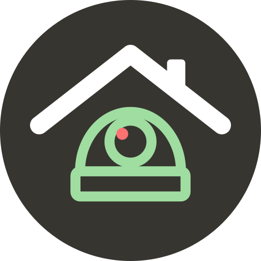

<p align="center">
  
</p>

<h1 align="center">HomeView</h1>

<p align="center">
  <b>See your camera from any screen at home, and from away.</b><br>
  A private camera viewer for Kasa and most other cameras that runs entirely on your own computer.
</p>

<p align="center">
  <a href="https://github.com/meirgarfinkel/homeview/releases/latest/download/HomeViewSetup.exe"></a>
  &nbsp;
  <a href="https://github.com/meirgarfinkel/homeview/releases/latest/download/HomeView.dmg"></a>
  &nbsp;
  <a href="https://github.com/meirgarfinkel/homeview/releases/latest/download/HomeView.deb"></a>
</p>

Watch and listen to your home camera in any web browser on your home
Wi-Fi. You don't need the camera maker's phone app, and nothing goes through
the internet unless you turn on away-from-home viewing. It was built to use a
Kasa Spot Pan Tilt (KC410S) as a baby monitor, and works with most other
cameras too.

- Live video and sound in the browser, with a sound meter and an alert when
  it gets loud
- Pan and tilt the camera with on-screen buttons or the arrow keys
- Tap the picture for fullscreen; snapshot and picture-in-picture buttons up top
- Works on phones, tablets and computers on your home network
- Optional viewing away from home, with nothing to install on the phone
- Protected by a password of your choice

## Install from the downloads

You don't need a terminal for any of this. You need the camera, plugged in,
and a computer that stays on while you want to watch. That computer runs
HomeView, and every phone or tablet in the house watches through it. It
must be on the same home Wi-Fi or network as the camera. Plan on about 20
minutes.

### 1. Download the file for your computer

Pick one file from the [latest release](https://github.com/meirgarfinkel/homeview/releases/latest). All releases are on the
[Releases page](https://github.com/meirgarfinkel/homeview/releases).

| Your computer                    | File                                                                                                                    |
| -------------------------------- | ----------------------------------------------------------------------------------------------------------------------- |
| Windows                          | [HomeViewSetup.exe](https://github.com/meirgarfinkel/homeview/releases/latest/download/HomeViewSetup.exe)               |
| Mac (Apple Silicon or Intel)     | [HomeView.dmg](https://github.com/meirgarfinkel/homeview/releases/latest/download/HomeView.dmg)                         |
| Linux, Ubuntu, Debian or similar | [HomeView.deb](https://github.com/meirgarfinkel/homeview/releases/latest/download/HomeView.deb)                         |
| Linux, other distributions       | [HomeView-x86_64.AppImage](https://github.com/meirgarfinkel/homeview/releases/latest/download/HomeView-x86_64.AppImage) |

On Ubuntu and Debian, pick the .deb. The AppImage needs a system part
(libfuse2) that newer versions of Ubuntu don't include, so it may not open.

The files are not signed with a paid developer certificate, so Windows and
macOS warn you once. The steps below say what to click.

### 2. Install it

**Windows.** Double-click `HomeViewSetup.exe`. Windows may show "Windows
protected your PC". Click "More info", then "Run anyway". The installer
needs no administrator password. It installs for your user only and adds
Start menu and desktop shortcuts.

**Mac.** Double-click `HomeView.dmg` and drag HomeView to Applications.
Open it from Applications. macOS says it can't verify the app. Click
"Done", open System Settings, go to "Privacy & Security", scroll down, and
click "Open Anyway" next to HomeView. Enter your Mac password if asked.
You need macOS 12 or newer. HomeView shows only in the menu bar, with no
Dock icon.

**Linux, .deb.** Double-click the file and choose "Install" in the software
installer. Then open HomeView from your applications menu.

**Linux, AppImage.** Right-click the file, choose "Properties", then
"Permissions", and turn on "Allow executing file as program" (in some file
managers the item is "Run as a program"). Then double-click the file.

**Updates install themselves:** when a new version is out, HomeView downloads it and offers to restart into it.

### 3. Open HomeView and follow the pages

HomeView opens your browser on a welcome page, on this computer only.

1. "Welcome to HomeView". Choose a password of at least 8 characters and
   click "Next". Everyone who watches will type it, on any phone or computer.
2. "Which camera do you have?". Click "Kasa", or "Another brand" for a
   Reolink, Tapo, Amcrest or other standard camera (see
   [Cameras from other brands](#cameras-from-other-brands)).
3. For a Kasa camera, "Your camera". Choose the line that fits.
   - "It already works in the Kasa app". Type your Kasa email and password,
     click "Connect", and pick the camera if more than one shows.
   - "It's new or reset, and I have a TP-Link account". The camera links to
     a free TP-Link account, so the Kasa phone app works with it too. No
     account yet? Create one at
     [myproducts.tp-link.com](https://myproducts.tp-link.com) first, and
     confirm it from the email TP-Link sends you. The next page, "Your
     TP-Link account", asks for that account's email and password.
   - "It's new or reset, and I don't want an account". The camera never
     links to any account and never talks to TP-Link. The cost is that it
     keeps its built-in `admin` / `admin` login, so anyone on your Wi-Fi who
     knows it could watch the camera directly. Choose this only if you trust
     everyone on your Wi-Fi. The Kasa phone app can't be used with it. To use
     the app later, reset the camera and set it up again with an account.
4. For a new or reset camera, the page then walks you through the camera
   setup. The camera records nothing until it finishes.
   - "Reset the camera". Hold the camera's reset button until it resets
     (its manual says how long). After about a minute it starts its own
     Wi-Fi network, named like `Kasa_Cam_1A2B`. Click "The camera is reset".
   - Linux joins the camera's network by itself. On a Mac or Windows the page
     says "Join the camera's Wi-Fi". Open this computer's Wi-Fi menu and join
     the network named like `Kasa_Cam_1A2B`. It has no password. The page
     carries on by itself once you have.
   - "Choose your home Wi-Fi". Pick your network, type its password, and
     name the camera, for example `nursery`. The camera only works on
     2.4 GHz Wi-Fi. If your network is missing, your router may broadcast
     only 5 GHz, so check its settings.
   - On a Mac or Windows, "Rejoin your home Wi-Fi" asks you to switch this
     computer back. The page waits up to 5 minutes for the camera to join
     your Wi-Fi, and moves on by itself once it has. On Linux this happens
     by itself, with a wait of up to 2 minutes.
5. "All set" shows the live picture and a QR code.

On Windows, a prompt may ask whether to allow HomeView on networks. Allow
it on private networks, or phones can't connect.

### 4. Watch on phones and other computers

1. On the "All set" page, scan the QR code with the phone's camera, or type
   the address under it, for example `https://192.168.1.20:8090`. The phone
   must be on your home Wi-Fi, not mobile data.
2. The phone warns that the connection isn't private. This is expected. Kasa
   Home makes its own security certificate, and browsers only trust
   certificates issued by a company. The connection is still encrypted. Tap
   "Advanced", then "Proceed" (or "visit this website"). Each browser asks
   only once.
3. Type the password you chose.
4. Tap the speaker button in the Sound panel to turn on sound. Browsers need
   one tap before they play sound.

On the computer that runs HomeView, use `http://localhost:8090` instead.
That address gives no certificate warning. If port 8090 is taken, HomeView
uses the next free port, up to 8099, and the "All set" page shows the real
address. On a phone, "Add to Home Screen" in the browser menu opens the
monitor like an app.

### 5. Change things later and keep it running

The tray icon (the menu bar on a Mac) has four items:

- "Open HomeView" opens the page in your browser.
- "Start with this computer" starts HomeView when you log in. It is also a
  checkbox on the "All set" page and in Settings.
- "Show logs" opens the log file, which helps when asking for help.
- "Quit" stops HomeView. Nobody can watch until you open it again.

Open the Settings page with the gear button on the monitor. Its sections are
Camera, Video, Access and App. On the computer itself it lets you change the
viewer password, the camera login, set up a new or reset camera ("Set up a
camera"), turn on starting with the computer and stop HomeView ("Stop
HomeView").

Under Video, "Video quality" picks the picture size: the camera's default,
720p, 1080p, or 2K when the camera can do it. Higher looks sharper and uses
more data, which matters most for a phone on mobile data. The picture
changes a few seconds after you pick.

Some Linux desktops show no tray icon. Stock GNOME, for example on Fedora,
needs an AppIndicator extension. Without one, open HomeView again from your
applications menu to get the page, and use "Stop HomeView" in Settings to
quit.

If you forget the viewer password, open the login page on the computer
itself and click "Forgot it? Set a new password". Phones can't do this.

HomeView keeps its settings and logs in this folder:

| System  | Folder                                   |
| ------- | ---------------------------------------- |
| Linux   | `~/.config/HomeView`                     |
| Windows | `%APPDATA%\HomeView`                     |
| macOS   | `~/Library/Application Support/HomeView` |

### 6. Watch away from home

By default the camera is visible only on your home Wi-Fi. Away from home
turns that on for your phone's normal browser on any network, including
mobile data. You install nothing on the phone and change nothing on the
router. It is part of the desktop app. It isn't available when you run from
source.

You need a free [Tailscale](https://tailscale.com) account. Tailscale is a
service that connects your computer to the internet and gives it a web
address ending in `.ts.net`. You can sign in with an account you already
have, such as Google or Apple. HomeView includes the part of Tailscale it needs, so you don't
install the Tailscale app. You also need to have finished setup and chosen a
viewer password, because HomeView won't turn this on without one.

1. **Turn it on.** On the computer, open Settings, find "Away from home" and
   tick "Watch from anywhere with your phone's browser".
2. **Sign in once.** Click "Sign in". Your browser opens Tailscale's sign-in
   page. Sign in or create the free account.
3. **Approve once.** Click "Approve". Tailscale asks you to allow HomeView
   to share a web address. Allow it.
4. **Add a phone.** Settings now shows your address, for example
   `https://homeview.tail1234.ts.net`, and an "Add a phone" button. Click it
   and scan the code with the phone's camera. The code works once and
   expires after 10 minutes. The phone opens the camera. The first time, the
   address can take a few minutes to start working. If the phone can't reach
   it, wait a few minutes and scan a new code.

Steps 2 and 3 happen once. After that, HomeView reconnects by itself when
it starts. Tailscale asks you to sign in again every few months, when the
computer's key expires. To avoid that, open the Machines page in the
[Tailscale admin console](https://login.tailscale.com/admin/machines), open
the menu for the `homeview` machine and choose "Disable key expiry". A phone that is already signed in at home can do step 4 without
the computer. Open its Settings and tap "Use this phone away from home".

The address works at home and away, so a phone needs only one bookmark. Use
"Add to Home Screen" in the browser menu. A paired phone stays paired. Its sign-in
lasts 30 days. After that, or after you change the viewer password, it asks
for the viewer password again, and you don't need to scan a new code.

**What Tailscale can see.** Video, sound and the password are encrypted
between your computer and your phone. Tailscale relays that encrypted
traffic and can't read it, so it can't see the video. It does know your
account and that your computer is online. HomeView
runs no servers of its own and sees none of your video.

**What stays the same.**

- The computer must stay on, with HomeView running, and connected to the
  internet. If it sleeps or you quit HomeView, the phone can't connect.
- Only phones you paired can reach the camera. A phone that opens the address
  without being paired sees "This phone isn't set up to watch from away" and
  can't try a password.
- Settings, camera setup, password changes and "Stop HomeView" work only on
  the computer. They are refused from away, even from a paired phone.
- The address is public, so strangers can find it and open it. They get the
  same "isn't set up" page.

**Remove a phone.** In Settings on the computer, find the phone in the list
under your address and click "Remove". It loses access on its next request,
and any live view it has open closes.

**Turn it off.** Clear the tick in "Away from home". HomeView stops
sharing the address. Your paired phones are kept, so turning it back on needs
no new scans. To also forget the Tailscale login, click "Sign out of
Tailscale", the small link in that section, while it is on. That turns it off
too. You then sign in to Tailscale again the next time you turn it on. The
address may change after that, for example to `homeview-1`, and your phones
may need to scan a new code.

If the section shows a problem, click "Try again".

### If something goes wrong

- **A phone shows "HomeView isn't set up yet".** Finish setup on the
  computer that runs HomeView. Setup pages answer only that computer.
- **The page doesn't open on a phone.** Make sure the phone is on your home
  Wi-Fi, not mobile data, and that the address starts with `https://` and
  ends with the port, for example `:8090`.
- **No picture, or the camera isn't found.** Check the camera's light shows
  it's connected, and that the computer is on the same Wi-Fi network as the
  camera, not a guest network.
- **Windows or the Mac won't open the installer.** See step 2. Both warnings
  appear once and are expected for unsigned apps.
- **No tray icon on Linux.** See step 5.
- **No sound.** Tap the speaker button in the Sound panel, because browsers
  block sound until you tap something. Check the phone isn't on silent.
- **The camera setup stops part way.** Click "Try again" if the page offers
  it, or reset the camera and start over. The Kasa phone app can also set up
  the camera as usual, and HomeView then works with it ("It already works
  in the Kasa app").
- **Anything else.** Open the tray menu, choose "Show logs", and read the end of
  the file.

## Run from source

This is for people comfortable with a terminal, and for the Linux systemd
setup. The installed app and `pnpm start` are separate. The app never reads
`.env`. `pnpm start` reads `.env`, and any variable set there or in the
environment overrides the matching value in `settings.json`.

You need [Node.js](https://nodejs.org) 22.12 or newer (the LTS version) and
pnpm 10. Linux is tested. macOS should work the same way, and Windows hasn't
been tried.

```bash
npm install -g pnpm@10   # add sudo on Mac or Linux if you get "permission denied"
git clone https://github.com/meirgarfinkel/homeview.git
cd homeview
pnpm install
pnpm build
cp .env.example .env
chmod 600 .env           # the file holds passwords
```

Open `.env` and set at least these, with no spaces around the `=` sign.
Put values containing spaces or `#` in single quotes.

```ini
VIEWER_PASSWORD=sleepy-owl-42        # 8 or more characters
KASA_USERNAME=you@example.com        # Kasa account email, or the camera's own login
KASA_PASSWORD=your-kasa-password
```

For a new or reset camera, run `pnpm setup-camera` and answer the prompts.
Choose `1` for an account or `2` for local only. It resets the camera,
switches your computer to the camera's Wi-Fi (Linux does this by itself, on a
Mac you join `Kasa_Cam_1A2B` yourself), asks for your home Wi-Fi name and
password, and waits for the camera to appear (up to 2 minutes, or 5 when
you switch networks by hand). The camera
needs 2.4 GHz Wi-Fi, and this computer needs Wi-Fi for this step. For local
only, answer `y` when it offers to save the camera's login into `.env`. It
prints `Done.` when finished.

Then check and start:

```bash
pnpm probe   # reads from the camera only; expect a "Camera" line and "Stream (5 s)" with frames
pnpm start   # look for "HomeView is running", which includes the address to open
```

`pnpm discover` lists every Kasa device the computer can see. Keep the
terminal open, because closing it stops HomeView. After changing `.env`,
stop it with Ctrl+C and run `pnpm start` again.

### Keep it running in the background (Linux)

1. Find Node.js with `which node`, and this folder with `pwd`.
2. Create `~/.config/systemd/user/homeview.service` with the text below,
   replacing `/home/you/homeview` and `/usr/bin/node` with your paths.

   ```ini
   [Unit]
   Description=HomeView
   Wants=network-online.target
   After=network-online.target

   [Service]
   WorkingDirectory=/home/you/homeview
   Environment=NODE_ENV=production
   ExecStart=/usr/bin/node apps/server/dist/index.js
   Restart=on-failure
   RestartSec=10
   UMask=0077

   [Install]
   WantedBy=default.target
   ```

3. Turn it on:

   ```bash
   systemctl --user daemon-reload
   systemctl --user enable --now homeview
   loginctl enable-linger "$USER"
   ```

   The last line keeps it running when you aren't logged in. View its
   messages with `journalctl --user -u homeview -f`, and restart it after a
   `.env` change with `systemctl --user restart homeview`. On a Mac, a tool
   such as [pm2](https://pm2.keymetrics.io) can do the same job.

### Troubleshooting for source installs

- **"No Kasa camera answered".** Run `pnpm discover`, and check the computer
  is on the camera's Wi-Fi network, not a guest network.
- **The login is rejected.** Check the email and password in `.env` match the
  account the camera is linked to, with no spaces around `=`.
- **"VIEWER_PASSWORD" error when starting.** Set a viewer password of at
  least 8 characters in `.env`.
- **`pnpm setup-camera` stops part way.** Reset the camera and run it again.

## Which cameras work

Tested with a KC410S on firmware 2.3.27. Other plug-in Kasa cameras that use
the same local protocol (Kasa `IOT.IPCAMERA` models such as the KC100,
KC105, KC110, KC115, KC120, KC125, KC200, KC400, KC401, KC411S, KC420WS,
EC60, EC70, EC71 and KD110) will probably show video and sound. Pan and tilt
appear only on cameras that can move. Battery cameras that connect through a
Kasa hub (the KC300/KC310 family) use a different system and don't work.
`pnpm probe` tells you within seconds whether a Kasa camera works.

### Cameras from other brands

HomeView also works with cameras that speak the two common standards,
ONVIF (for finding the camera and for pan and tilt) and RTSP (for the
video). Most cameras sold for home use do, including Reolink, Tapo, Amcrest,
Hikvision, Dahua and Annke. This support is new and has so far been tested
against a simulated camera only; if your camera doesn't work, please open an
issue with its make and model.

In setup, choose "Another brand". HomeView searches your Wi-Fi and lists
the cameras it finds. Not in the list? Type its address: either the
camera's IP address (with `:port` if its ONVIF port isn't 80), or its full
`rtsp://` stream address. A typed stream address gives video and sound but
no pan and tilt.

Make sure the camera is set up in its own app and on your Wi-Fi first. Then:

- Tapo: in the Tapo app, create a "Camera account" (Advanced settings). Use
  that, not your Tapo login.
- Reolink: turn on ONVIF and RTSP in the camera's network settings if they
  are off.
- Others: use the camera's admin username and password.

HomeView picks a stream of at most 1080p to keep phones smooth. You can pick
another one under Settings, Video, "Stream". Under Camera, "Camera in use",
you can change to a different
camera there too ("Change camera"). The old camera stays in use until the
new one connects.

Cameras that only work through their maker's cloud, such as Ring, Nest,
Arlo and most Wyze cameras, have no local stream and don't work.

Many of these cameras send H.265 video. HomeView passes it to the browser
as it is, without converting it. Safari and recent Chrome and Edge on most
computers and phones play it; Firefox and some older devices don't, and show
"This browser can't play this camera's video (H.265). Try another browser,
or set the camera to H.264 in its own app." Sound in AAC, G.711 A-law or
G.711 μ-law plays; other sound formats show "This camera's sound format
isn't supported yet." and the video still plays.

## Settings

The desktop app stores its settings in `settings.json` in its data folder and
changes them from the Settings page. `pnpm start` reads `.env`, which wins
over `settings.json`. See [.env.example](.env.example) for the full list with
explanations. The ones you might change:

| Setting                  | Default            | What it does                                                                             |
| ------------------------ | ------------------ | ---------------------------------------------------------------------------------------- |
| `KASA_USERNAME`          | (required)         | Kasa account email, or the camera's login for local-only setup                           |
| `KASA_PASSWORD`          | (required)         | The matching password                                                                    |
| `VIEWER_PASSWORD`        | (required)         | Password for the web page, 8+ characters                                                 |
| `KASA_HOST`              | found by itself    | Pin the camera's IP address (normally found and followed by itself)                      |
| `KASA_ALIAS`             |                    | Which camera to use when there are several, by name                                      |
| `KASA_STREAM_RESOLUTION` | camera default     | `2560x1440`, `2304x1296`, `1080P`, `720P` or `360P`. Overrides Video quality in Settings |
| `PORT`                   | `8090`             | Web page port                                                                            |
| `HTTPS`                  | `true`             | Serve the page over HTTPS with its own or a supplied certificate                         |
| `TLS_CERT_FILE`          |                    | Use your own certificate (e.g. from mkcert), with `TLS_KEY_FILE`                         |
| `ALLOWED_CIDRS`          | this machine's LAN | Networks allowed to open the page                                                        |
| `PTZ_STEP_SPEED`         | `2`                | How far one tap moves the camera, 1 to 10                                                |
| `KASA_TIMEZONE`          | this computer's    | Time zone for the camera's clock and the time shown on the video                         |

HomeView finds the camera on its own and follows it if its IP address
changes. Before switching to a new address, it checks the camera's security
certificate matches, so another device can't pretend to be the camera. It
also keeps the camera's clock in this computer's time zone and rechecks every
hour, so daylight saving changes are picked up.

## Security

The page shows a live camera, so it is locked down by default:

- **Local network only.** HomeView refuses requests from outside this
  computer's home network, including Docker and VPN interfaces. Away from
  home is the one exception, and it is off until you turn it on. See step 6.
- **HTTPS** for video, sound, the password and the login cookie.
- **Password required.** The server won't start without `VIEWER_PASSWORD`
  unless you set `ALLOW_NO_PASSWORD=true`. Logins use signed, HttpOnly,
  `SameSite=Strict` cookies, and the server slows down repeated wrong
  passwords.
- **No DNS rebinding or cross-site use.** The server rejects unknown `Host`
  headers, cross-origin WebSockets and cross-origin POSTs, and sends a strict
  Content-Security-Policy.
- **Credentials stay on the server.** The server never sends them to the
  browser, never logs them, and never sends them to a camera address outside
  your network. It stores its generated secrets in `data/`, readable only by
  your user.
- **Nothing goes to the cloud.** The server only talks to the camera and to
  your browsers. With away from home on, the app also connects to Tailscale.

Don't port-forward this server to the internet. Use away from home instead.

The camera's own local protocol is weak, and this project can't change that:

- The camera checks the password as an unsalted MD5 hash.
- Control commands are only scrambled, not encrypted.
- Its encryption has no forward secrecy.
- It tells anyone on your network the location set in the Kasa app.
- It gives out your Wi-Fi password in plain text to anyone with the camera's
  login.

So:

- Use a unique Kasa password with two-step verification turned on.
- Turn off UPnP on your router.
- If you can, put cameras on their own network.

## How it works

```text
Kasa camera ──HTTPS :19443──▶ server ──WebSocket (fMP4 + G.711)──▶ browser (MSE + Web Audio)
            ◀─HTTPS :10443──         ◀──────── REST (pan/tilt) ──────────
```

The server pulls the camera's multipart H.264/G.711 stream, wraps each video
frame in a fragmented-MP4 segment and sends it to every viewer over a
WebSocket. The browser plays it with Media Source Extensions and plays the
sound through Web Audio. Only one connection to the camera is open, however
many people watch. [docs/PROTOCOL.md](docs/PROTOCOL.md) describes the
camera's protocol, including how `pnpm setup-camera` works.

```text
apps/server     Fastify server: camera client, fMP4 muxer, live hub, API
apps/web        React + Vite single-page app
packages/shared Types shared by both (WebSocket and API messages)
docs/           Camera protocol notes
```

## Development

```bash
pnpm dev              # API server (tsx watch) + Vite on http://127.0.0.1:5173
pnpm dev:fake-camera  # optional: a simulated camera on 127.0.0.1
pnpm dev:fake-onvif   # optional: a simulated standard (ONVIF) camera, H.265 + AAC
pnpm test             # unit + integration tests (uses a fake camera; ffmpeg optional)
pnpm lint
pnpm typecheck
pnpm format
pnpm check            # all of the above, as CI would run them
```

The integration tests run against an in-process fake camera that speaks the
same protocol, so they need no real camera or credentials. To rehearse
`pnpm setup-camera` without a camera, run
`FAKE_CAMERA_SETUP=1 pnpm dev:fake-camera` and follow what it prints.

## Disclaimer

This is an independent project, not affiliated with or endorsed by TP-Link.
Kasa is a trademark of TP-Link. The protocol was worked out for
interoperability with hardware you own; no TP-Link code is included.

## License

[MIT](LICENSE)
